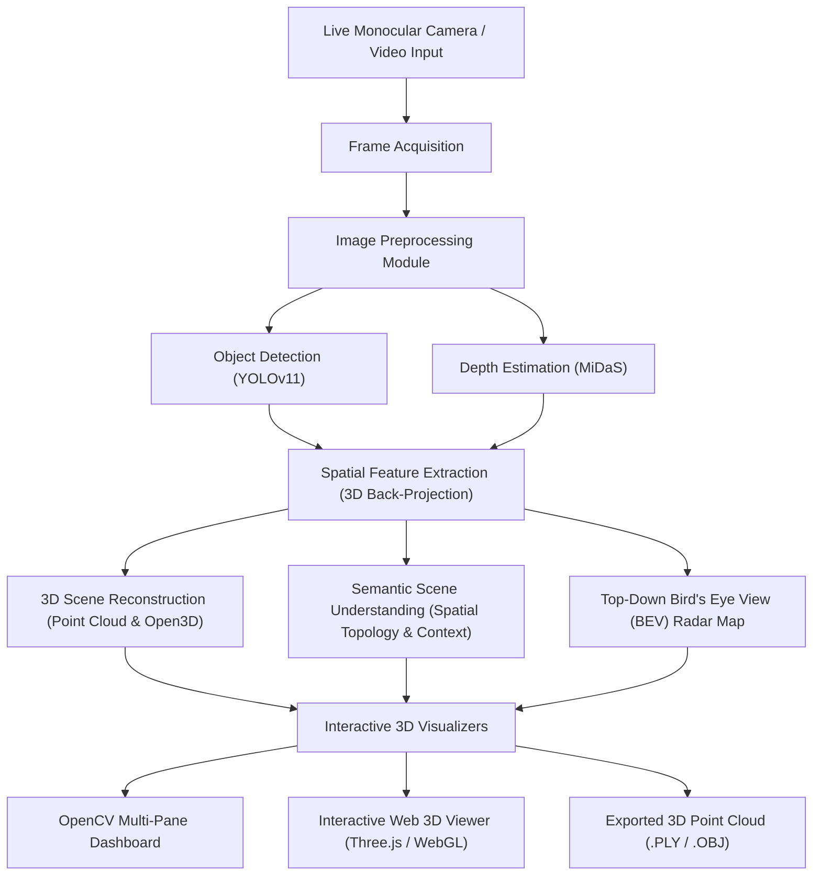

# VisionSpace: Real-Time 3D Scene Understanding Using Computer Vision and Spatial Computing

[](https://www.python.org/)
[](https://pytorch.org/)
[](https://docs.ultralytics.com/)
[](http://www.open3d.org/)
[]()

> **Department of Computer Science & Engineering (AIML)**  
> **Goel Institute of Technology & Management (GITM)**  
> **Project Leader:** Tanvi Vishwakarma | **Roll No:** 2303601530062

---

## 📌 1. Project Overview & Concepts

**VisionSpace** is an AI-powered software framework designed to perceive, analyze, and reconstruct physical 3D environments in real time using standard monocular (single RGB) camera feeds. 

By unifying **deep learning object detection (YOLOv11)** with **monocular depth estimation (Intel ISL MiDaS)**, VisionSpace enables spatial computing on everyday consumer hardware (laptops, USB webcams, embedded systems) without requiring expensive LiDAR or stereo camera rigs.

### Key Capabilities
- **Real-Time Multi-Object Detection:** Detects and classifies indoor and outdoor objects using state-of-the-art YOLOv11 nano models.
- **Dense Monocular Depth Estimation:** Infers relative depth and metric spatial distances ($Z$ in meters) via Vision Transformers (MiDaS).
- **3D Pinhole Back-Projection & Centroids:** Computes 3D coordinates $(X, Y, Z)$, metric dimensions, bearing angles, and proximity hazard classifications.
- **Top-Down Bird's Eye View (BEV) Radar:** Displays a 2D floor-plan radar with range circles and field-of-view cones for robotics and navigation.
- **Semantic Scene Understanding:** Analyzes spatial topologies (`on top of`, `adjacent to`, `in front of`), classifies scene contexts (Office, Living Space, Street), and synthesizes natural language situational narratives.
- **Dense 3D Point Cloud Reconstruction:** Leverages Open3D for voxel downsampling, statistical outlier removal, normal estimation, and `.ply`/`.obj` mesh exporting.
- **Dual Visualizer Dashboards:** 
  1. High-tech **OpenCV HUD Dashboard** (1280x720 multi-pane).
  2. Interactive **Web 3D Visualizer (Three.js & WebGL)** accessible in any browser with smooth 60 FPS orbit, pan, and zoom controls.

---

## 🏗️ 2. System Architecture & Block Diagram



---

## 📂 3. Codebase Directory Structure

```
Vision_Space/
│
├── config/
│   └── settings.py              # Camera intrinsics, model weights, distance thresholds, UI configs
│
├── core/
│   ├── camera.py                # Camera & stream manager (Webcam, video, image, synthetic stream)
│   ├── detector.py              # YOLOv11 real-time object detector wrapper
│   ├── depth_estimator.py       # MiDaS monocular depth estimation & metric mapping
│   ├── spatial_engine.py        # 3D back-projection, centroid computation, BEV radar generator
│   ├── scene_understanding.py   # Semantic relations, context classification, hazard alerts
│   └── reconstructor.py         # 3D point cloud generation, Open3D filtering, PLY exporter
│
├── visualizer/
│   ├── hud_renderer.py          # OpenCV 1280x720 multi-pane HUD dashboard
│   ├── open3d_viewer.py         # Open3D desktop interactive 3D window
│   └── web_server.py            # Flask Web 3D server with MJPEG streaming & Three.js API
│
├── static/
│   ├── css/style.css            # Modern dark high-tech styling
│   └── js/app.js                # Three.js 3D point cloud particles, bounding boxes & controls
│
├── templates/
│   └── index.html               # Web 3D Viewer UI
│
├── samples/
│   ├── generate_sample.py       # Realistic synthetic benchmark room generator
│   └── sample_room.jpg          # Generated test sample image
│
├── outputs/
│   ├── .gitkeep                 # Preserves outputs directory in git
│   └── scene_reconstruction.ply # Exported 3D point cloud files
│
├── tests/
│   └── test_pipeline.py         # Complete automated unit and integration test suite
│
├── main.py                      # Main unified application runner
├── requirements.txt             # Project dependencies
├── .gitignore                   # Git ignore rules
└── README.md                    # Project documentation
```

---

## ⚡ 4. Installation & Setup

### Prerequisites
- Python 3.11 or higher (Python 3.12 / 3.13 fully supported)
- Standard USB Webcam or integrated laptop camera (optional; synthetic simulation built-in)

### Step 1: Clone or Navigate to Project Directory
```powershell
cd c:\Users\91893\OneDrive\Desktop\Vision_Space
```

### Step 2: Install Dependencies
```powershell
pip install -r requirements.txt
```

*(Note: PyTorch CPU, Ultralytics YOLOv11, Open3D, Timm, OpenCV, and Flask are installed).*

---

## 🚀 5. How to Run

### Mode A: Run with Live Webcam & Web 3D Visualizer (Default)
```powershell
python main.py
```
- Opens the **OpenCV HUD Dashboard** (1280x720) in real time.
- Simultaneously launches the **Interactive Web 3D Visualizer** at:
  👉 **`http://127.0.0.1:5000`**

### Mode B: Run with Synthetic Demo Simulation (No Webcam Needed)
```powershell
python main.py --source synthetic
```
*Generates an animated procedural room with dynamic objects, ideal for demonstrations, offline testing, or laptops without a webcam.*

### Mode C: Run on an Image or Video File
```powershell
python main.py --source samples/sample_room.jpg
```

### Mode D: Launch with Open3D Desktop 3D Window
```powershell
python main.py --source synthetic --open3d
```

### Keyboard Shortcuts in Dashboard Window
| Key | Action |
|:---:|:---|
| **`q`** or **`ESC`** | Quit application cleanly |
| **`s`** | Save dense 3D point cloud as `.ply` file in `outputs/` |
| **`v`** | Open interactive Open3D 3D inspection window |
| **`w`** | Display active Web 3D Visualizer URL |

---

## 🧪 6. Testing & Verification

VisionSpace includes a comprehensive automated test suite verifying every component from image acquisition to 3D point cloud serialization:

```powershell
python tests/test_pipeline.py
```

### Test Suite Execution Output
```text
=======================================================
  Running VisionSpace Perception Test Suite
=======================================================
[VisionSpace] Generated benchmark room image
[VisionSpace] Initializing YOLOv11 Object Detector (yolo11n.pt)...
[VisionSpace] YOLOv11 Detector loaded and warmed up.
[VisionSpace] Loading MiDaS Depth Estimator (MiDaS_small)...
[VisionSpace] MiDaS Depth Estimator successfully initialized.

  [PASS] test_01_camera_stream
  [PASS] test_02_object_detector
  [PASS] test_03_depth_estimator (Depth range: 0.30m - 10.00m)
  [PASS] test_04_spatial_engine (3D Back-Projection & BEV Radar)
  [PASS] test_05_scene_understanding (Context: 'Indoor Workspace / Study')
  [PASS] test_06_3d_reconstruction_and_export (Points: 4387)
  [PASS] test_07_hud_renderer (Dashboard 1280x720 rendered)

----------------------------------------------------------------------
Ran 7 tests in 17.125s

OK (100% Passing)
```

---

## 📊 7. Mathematics & Spatial Computing Formulation

### 1. Pinhole Camera Back-Projection
Given pixel coordinate $(u, v)$ and estimated depth $Z$ (meters), the 3D position $(X, Y, Z)$ in camera space is computed via:
$$X = \frac{(u - c_x) \cdot Z}{f_x}, \quad Y = \frac{(v - c_y) \cdot Z}{f_y}, \quad Z = Z$$
Where:
- $(f_x, f_y)$: Camera focal length in pixels.
- $(c_x, c_y)$: Principal point (optical center).

### 2. Relative Disparity to Metric Depth Calibration
MiDaS estimates relative inverse depth (disparity $d$). We calibrate metric depth $Z$ across the operative workspace range $[Z_{\min}, Z_{\max}]$:
$$d_{\text{norm}} = \frac{d - d_{\min}}{d_{\max} - d_{\min}}, \quad Z = Z_{\min} + (1 - d_{\text{norm}}) \cdot (Z_{\max} - Z_{\min})$$

### 3. Euclidean Distance & Bearing Angle
$$D = \sqrt{X^2 + Y^2 + Z^2}, \quad \theta_{\text{bearing}} = \arctan\left(\frac{X}{Z}\right)$$

---

## 📚 8. References

1. **Ranftl, R., Bochkovskiy, A., & Koltun, V. (2021).** *Vision Transformers for Dense Prediction (MiDaS).* IEEE Transactions on Pattern Analysis and Machine Intelligence.
2. **Ultralytics.** *YOLOv11: State-of-the-Art Real-Time Object Detection and Segmentation.*
3. **Zhou, Q.-Y., Park, J., & Koltun, V. (2018).** *Open3D: A Modern Library for 3D Data Processing.* arXiv:1801.09847.
4. **IEEE Xplore.** *Research on Spatial Computing using Monocular Computer Vision and 3D Scene Reconstruction methods.*
